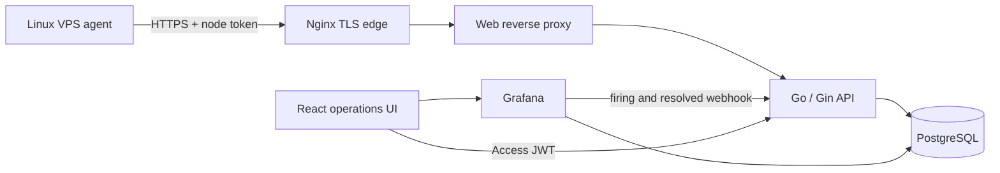

# Architecture

VPSentinel uses a push model because monitored VPS instances are distributed
across the public internet. Each agent only needs outbound HTTPS access; the
operator does not expose a new inbound metrics port on every host.

## Trust boundaries

- Agent tokens are random per node and stored only as SHA-256 hashes. Revoking
  one token does not interrupt the rest of the fleet.
- Admin login returns a 15-minute access JWT. A seven-day refresh JWT is held
  in an HttpOnly, SameSite=Strict cookie, hashed in PostgreSQL, rotated on every
  use, and revoked on logout. Reusing a rotated refresh token fails.
- Grafana uses a dedicated webhook secret and is reachable only through the
  authenticated `/grafana/` reverse-proxy path.
- PostgreSQL, Grafana, and the Go API have no public container ports. Only the
  web proxy binds to loopback; host Nginx terminates public TLS.
- Client addresses travel in `X-Real-IP`, which each proxy overwrites. The web
  proxy accepts it only from loopback and private peers, and the API only from
  the internal network, so rate limits (including 10 logins per minute per
  client) apply per real client rather than per proxy.

## Reliability model

Agents collect immediately and then every 15 seconds. A bounded queue preserves
recent samples through temporary server failures, while exponential backoff
with full jitter avoids a retry storm. Stable sample IDs and database unique
constraints make retries idempotent. The server handles SIGTERM gracefully
and deletes metrics older than the configured retention period once per day.
Versioned migrations run as a separate one-shot `migrate` job, guarded by an
advisory lock, before the API starts.

## Status semantics

- `online`: last accepted metric or heartbeat is at most two minutes old.
- `degraded`: last contact was between two and five minutes ago.
- `offline`: last contact was more than five minutes ago.
- `pending`: the node was registered but has never connected.

Grafana fires its offline alert after two minutes; the broader degraded/offline
UI bands help operators distinguish a delayed agent from a sustained outage.
